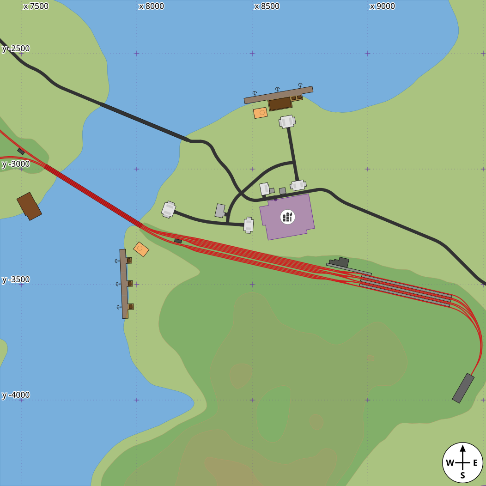
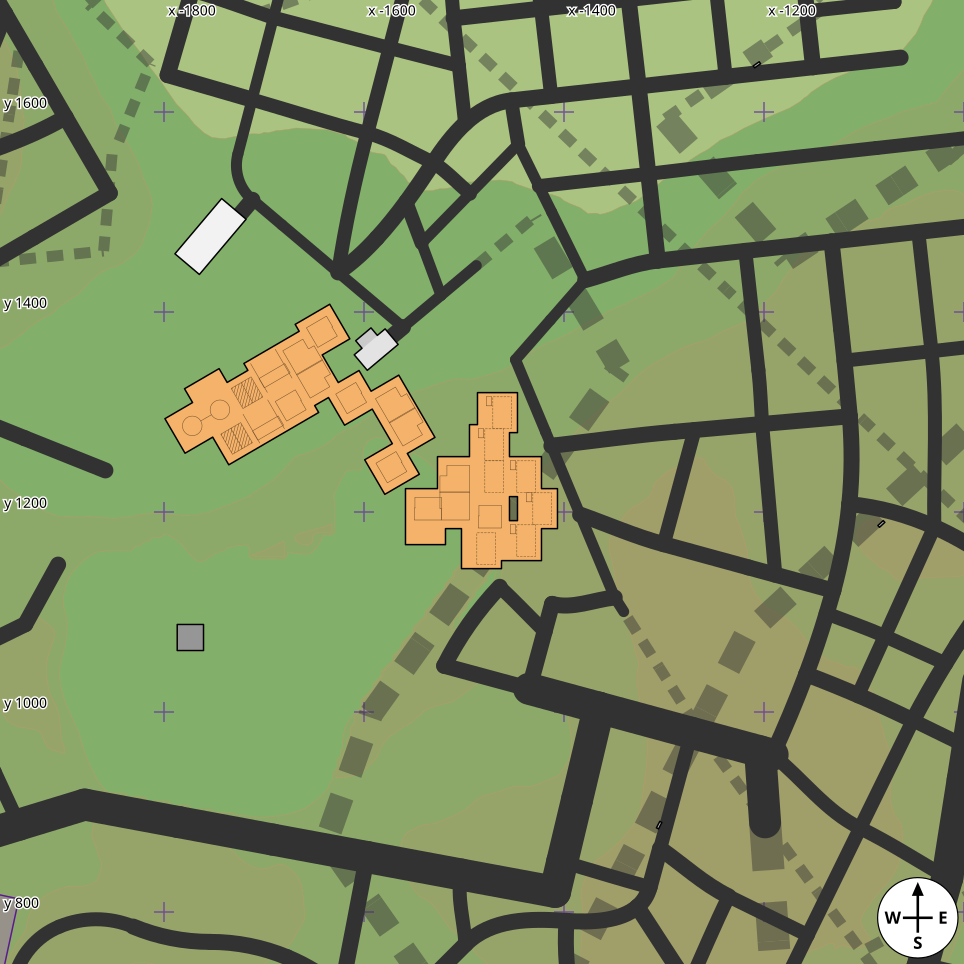
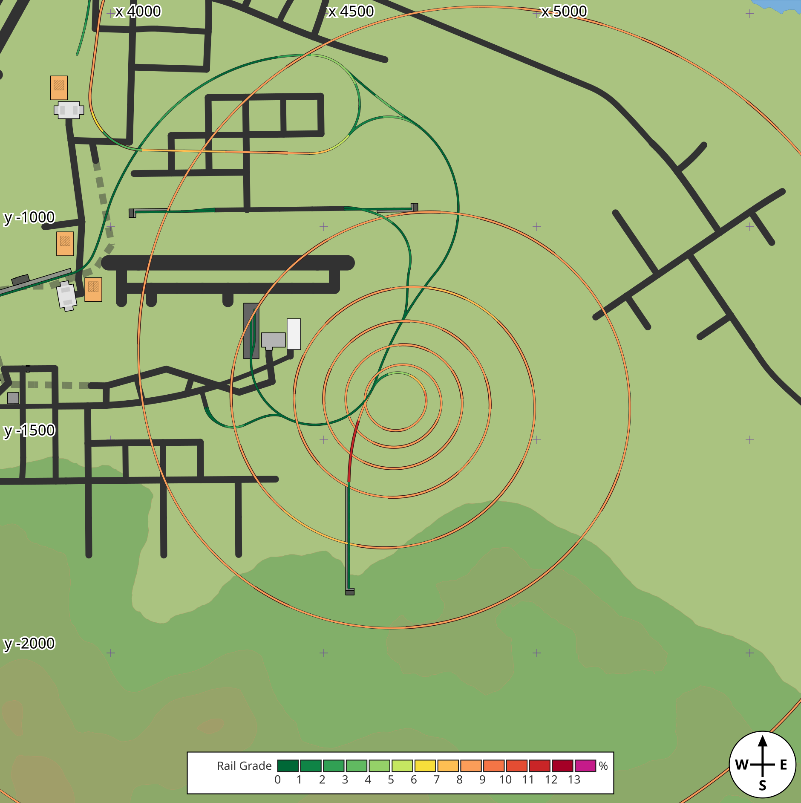

# tf3-save-mapper

Draw an SVG map of a Transport Fever 3 save: terrain, roads, rails, stations, depots, warehouses and industries. It can also write a flat PNG of the terrain and the network. Unofficial, and not affiliated with or endorsed by Urban Games or Paradox Interactive.

The tool reads a `.sav` file and writes a vector map you can open in a browser or an editor. It is read-only: it never writes or changes a save.



*`tf3map SAVE --crop 8460,-3320,1050 --mpp 2`. The example maps are redrawn with the current build by [docs/regenerate-examples.sh](docs/regenerate-examples.sh).*

## What the map shows

The whole map, north up and east right, in map metres, as layers that Inkscape and similar editors show as layers:

- **Terrain**: height bands every 20 m in a plain colour ramp, the water (lakes, sea and rivers), and height lines with every fifth one heavier. All vector shapes, cut from the save's heightmap. With `--raster`, one shaded picture instead (below).
- **Roads and rails** from the street edges in the save, one sublayer per street or track type. Each is as wide as its lanes, sidewalks included (a small town street 16 m, a track 4 m), and curves follow the stored bends.
- **Tunnels and bridges**: an edge in a tunnel is drawn faded and dashed, under everything that stands on the ground (stations, warehouses, depots, the roads above), each dash at least one and a half times the edge's width, with the dashes of tracks side by side lined up; an edge on a bridge is drawn over the roads and rails with a line along each side in a dark shade of its colour (near-black for a road, dark red for a track). Their sublayers are the road or rail sublayer's id with `-tunnel` or `-bridge` after it, inside the layers `tunnels` and `bridges`. The save does not say which edge a tunnel or bridge belongs to, so the edges are matched to the tunnel and bridge pieces the game lays along them: an edge most of whose length has pieces on it, at its height, is in a tunnel or on a bridge.

  

  *`tf3map SAVE --crop -1482,1231,480 --mpp 1`, on a save published in the mod.io catalogue.*
- **Stations**: the docks, platforms and buildings of water, rail and street stations, with a border round each bus, tram or cargo station and an anchor on each ship landing.
- **Depots and maintenance buildings** for road, tram, rail and ship, one grey or brown per carrier, and, when asked for, the area each one maintains.
- **Warehouses**: each warehouse's ground in orange with a black outline, under the roads, and inside it, in thin lines, what each module holds: a goods module's hall (connected halls run on), a bulk module's two bunkers, hatched, a liquid module's round tank and the pipes to its neighbours, a flatbed module's crane rails and crane, and a universal module's open yard, dashed, and shack. Each module's class is also in its `data-type`.
- **Industries**: each industry's footprint, and a badge with its icon. The industries' own sidings (`industry` track) are left out of the network, in every map and the PNG, whether or not the industries are drawn; the entrance road, which reaches out to the network, stays. An industry deleted in the map editor leaves its record and models in the save; its marker is left out, and so is one of the markers an industry leaves stacked at its spot when it loses a field (`--keep-dead` draws them all). This needs the save's free-id list.
- **Vehicles**, when asked for: one shape per vehicle, pointing where it faces.
- **Grades**, when asked for: each track, road or tram line coloured by how steep it is, over everything but the labels, grid labels and rose, with a key. More examples in [docs/grades.md](docs/grades.md).

  <a href="docs/images/rail-grades-helix.svg"></a>

  *`tf3map SAVE --crop 4680,-1410,940 --mpp 1 --rail-grades`, on a save published in the mod.io catalogue (6414627). Click for the full size.*
- **Texts**, when asked for: names placed by hand at map points (`--text`, `--text-file`), white on a dark rounded box as the game labels its towns. The save holds the names of towns and industries but not where a town is, so this is how to put them on the map for now.

  

  *`tf3map SAVE --crop 1700,-8000,4200 --text "-410,-7671=Deming" --text "5163,-9172=Quemado" --text "2019,-9340,small=Deming Logging Camp" --text "-1708,-5795,small=Deming Saw Mill"`, on the maintainer's own map.*
- A **grid** of map coordinates: marks at round values of x and y, labelled along the top and left edges.
- A **compass rose**, in the lower right corner unless asked elsewhere.

Each layer is a group marked as an Inkscape layer with a readable name (`inkscape:groupmode="layer"`, `inkscape:label`), so the Layers panel lists them in drawing order and each can be hidden or locked. It also has `class="layer"` and its id in `data-layer`, so a page script can find the layers with `g.layer`. A group that holds one vehicle, depot or badge inside a layer is not a layer.

The shapes of stations, depots and industry footprints, and the marks inside warehouses, come from the game's own files, read from your install when the tool runs (see below). The road depot is the exception: its script gives only the box round its lot, so it is drawn as the lot itself (the yard and the entrance box out to the road), an outline we measured from screenshots, while the script's box still agrees with it. Without an install the map still has the terrain, the network, the industry badges and the warehouses' ground, with nothing inside.

Drawing choices: labels are left out rather than moved, one outline width (1.5 m), no inner lines, plain dark anchors. By default the compass follows the game's own axes (x east, y north); `--north sun` turns the map to the north the sun's path gives. The colours are our own, not the game's.

## Using it

```
tf3map SAVE.sav                  # writes SAVE.svg in the current folder
tf3map SAVE.sav -o map.svg
tf3map SAVE.sav --png            # writes SAVE.png: the shaded terrain, roads and rails only
```

Options (`tf3map --help` lists them all):

- `--crop X,Y,R` draws only the square of half-width R metres round the map point X,Y (x east, y north, 0,0 the map's centre), at 4 m per pixel instead of 8. The picture keeps the whole map's frame, so its `viewBox` starts at the crop's corner. It is drawn from everything within 500 m of the square, so station borders, outlines and anchors come out as on the whole map, and holds what reaches into the square by its drawn shape (an edge by its width, a ship by its length). `--zoom N` makes the picture N times larger on screen.
- `--mpp M` sets the metres per pixel: a multiple of 4 (the heightmap's spacing), or 1 or 2 on a crop. The default is 8 for the whole map, and 4 on a crop and with `--raster` or `--png`. A coarser picture cuts the terrain from every (M / 4)th point of the heightmap; a finer one only scales the picture, since the heightmap has no more detail. Line widths and label sizes that are set in pixels follow it.
- `--game DIR`: the game's install folder, the one holding `base/`. By default the usual Steam folders and their library folders are tried.
- `--mods DIR`: the mod.io game's mods folder, the one holding a folder per mod, read for a mod's depots: the Boathouse mod's boathouse, the Roundhouse mod's roundhouse and the Modern Depot mod's depot. By default the mods folders beside the usual Steam folders are tried (for the snap, `~/snap/steam/common/mod.io/common/10640/mods`), then `~/.local/share/mod.io/common/10640/mods`. A roundhouse or modern depot is drawn from its pieces' model boxes, the turntable as a disc. Without the mods folder each of these depots is still drawn, as a dot, but with no catchment and no coverage circle.
- `--contour M` sets the metres between height lines and bands (default 20); `--no-bands` leaves the colour bands out.
- `--raster` draws the terrain as one picture embedded in the SVG (a PNG in a data URI): the same height colours with hill shading lit from the north-west, and the water from light to dark blue with depth. Everything else is drawn on top as before. It is 4 m per pixel unless `--mpp` says otherwise, and the file is megabytes where the vector terrain's is hundreds of kilobytes.
- `--png` writes one flat PNG instead of the SVG: the `--raster` terrain with the roads and rails drawn into its pixels, each as wide as its lanes and at least one pixel (tunnels faded and dashed, bridges with their dark sides, as in the SVG, and the grade colours when asked for), and nothing else (no stations, depots, warehouses, industries, vehicles, labels, grid or rose; the options for those are refused). A `tf3map:view` text chunk holds a JSON record of where the picture lies: the map size, the metres per pixel, which way north is, the map box it shows (`x-min`, `x-max`, `y-min`, `y-max`) and the crop.
- Every SVG carries a `<metadata>` element with a `tf3map:view` record (the same names as the PNG's chunk, as attributes), so a picture can be turned back into map coordinates without its command line. The record names the build in `generator-version` and, from a git checkout, `generator-commit` (the same text `tf3map --version` ends in: `tf3map 0.10.0 (a30365b0c1)`, with `-dirty` for uncommitted changes), so a stored map can be tied to the build that drew it. A source archive without git gives the plain version and no `generator-commit`, even when unpacked inside another git checkout. The record also lists the settings that differ from the defaults (`contour-step`, `index-every`, `bands`, `grid`, `grid-step`, `grid-lines`, `rose`, `zoom`, `industries`, `depots`, `stations`, `warehouses`, `terrain`, `vehicles`, `coverage`, `rail-grades`, `rail-grade-limit`, `road-grades`, `road-grade-limit`, `tram-grades`, `tram-grade-limit`, `keep-dead`, `mods` and so on), so a map says how it was made; a default run lists none. A setting is listed only where it can change the picture: no `rose-size` without a rose, no `grid-dot-step` without a grid, `mods` only when depots or coverage are drawn, and a PNG lists its `terrain` and `keep-dead` but not the layers it never has. The save's file name and the time are left out.
- Exit status, for a script that runs many saves: 0 the map was written; 1 something else failed (the save is missing or is a folder, no game install, no mods folder where `--mods` says, the output cannot be written); 2 the arguments are wrong (also: the output names a `.sav` or the save itself, the crop lies outside the map or shows less than 8 m of it, or the picture or grid would be too big or have no pixels at that `--mpp` or `--grid`); 3 the save was refused because the reader finds it unreadable (not zstd, empty, or no save inside). A failure writes one line `tf3map: MESSAGE` to stderr and no picture. Each run reads the install and the mods folder itself; that costs about 0.03 s on a small save, so a batch of saves is one run per save.
- `--no-terrain`, `--no-industries`, `--no-depots`, `--no-stations`, `--no-warehouses` and `--no-rose` leave a layer out.
- `--rose WHERE` puts the compass rose in a corner (`lower-right`, the default, `lower-left`, `upper-left`, `upper-right`), round the map point `X,Y`, or nowhere (`off`); `--rose-size M` sets its diameter (default 250 m, or a twelfth of the picture's shorter side when that is less; a size given is used as it is).
- `--north sun` turns the map so that up is +x and right is -y, the north the sun's path gives, instead of the game's own (`--north game`, the default: up is +y).
- `--min-width M` draws no road or track narrower than M metres, so tracks stay visible on a whole-map view.
- `--road-width M` and `--rail-width M` set the width of an edge whose lanes cannot be read (default 16 and 4).
- `--keep-dead` also draws the roads and tracks the game deleted or no longer uses but left in the save: those with an end node in the free-id list, those with neither end in the lane table, and short groups of industry road joined to nothing else and more than 200 m from every industry (the lane table also catches stale pieces of any type, town streets and tram track among them; the short groups are what a removed industry leaves of its road). Industry sidings stay out all the same (see Industries above). Without `--keep-dead`, a lane table that would leave out more than a third of the edges is taken as misread: those edges are drawn, and a note says so (the most seen in a real save was 15 %).
- `--coverage` draws the area each depot and maintenance building covers: a dashed circle at the catchment radius of its script, round its origin, under the roads, one sublayer per kind. A ship depot's ring in the game is sometimes tens of metres off its origin; this draws it on the origin.
- `--rail-grades` colours each track by its grade in a layer `grades`, drawn over everything taken from the save (vehicles included) and under the labels, grid labels and rose, so trouble spots show wherever they are. A grade is the height between the edge's two ends over its length along the curve, up or down alike; the game's build tool also shows one slope per segment. There are 14 colours: 13 bands from dark green on the level through yellow to dark red, one per whole percent (0 to 1 %, 1 to 2 % and so on up to 13 %), and magenta at 13 % and over. 13 % is the steepest the game's track types allow (`maxSlope`; its build tool stops at 8.5 %, `maxSlopeBuild`). `--rail-grade-limit P` moves the start of the magenta to P % and spreads the other 13 colours evenly below it (at 10, bands of about 0.77 %). Each line has a thin near-black edge so the colours show on any terrain. Each edge's path carries its grade in percent, two decimals, in `data-grade`, and the colour is chosen from that same number; each sublayer carries its limit in `data-limit`. Tracks in tunnels keep their dashes (at full strength, not faded); tracks on bridges are as wide as the bridge's fill, so its dark-red sides still show. The sublayers are `grades-rail-tunnel`, `grades-rail` and `grades-rail-bridge`. The PNG draws them too. Where a climb starts or ends the grade eases in along an edge, and the colour is that edge's mean.
- `--road-grades` does the same for the roads, a town street with tram lanes among them, and `--tram-grades` for the tram lines of their own (the game's `street/tram/` types: tram lanes and no road lanes). Their limit defaults to 20 % (`--road-grade-limit P`, `--tram-grade-limit P`), 13 colours of about 1.5 % each and magenta from 20 % up: as steep as the game builds them. The game's street types set no slope limit, but the saves show where it lies: of about 470,000 road edges in 213 published saves, 601 sit at exactly 20.0 % against about 185 at each tenth below it, and the tram lines and the streets with trams pile up there too. Early vehicles struggle well below it: worked out from their power, tractive effort and loaded weight, early buses and trams crawl at 10 to 20 km/h on 15 % and the weaker ones stall between 15 and 20 % (an estimate, as the game's vehicle physics is not in its files), so a lower limit such as 15 or 16 spreads the colours over the grades they manage. Their sublayers are `grades-road*` and `grades-tram*`, under the rails' (roads lowest), and the key has a row for each family drawn, in the same order.
- `--vehicles` draws the vehicles, coloured by kind. `--name SLOT=TEXT` writes TEXT beside the vehicle whose `data-slot` is SLOT (repeatable); a default name such as `Road Vehicle 279` is shortened to `RV279`. A `data-slot`, on vehicles, depots, stations, warehouses and industries alike, is the instance's place among all the save's model instances in stream order: the same number whichever layers are drawn, but only good within one save.
- `--label A>B[=TEXT]` writes TEXT (or `A>B`) along the edge between the nodes with hex ids A and B, in either order, and marks its ends (repeatable); `--edge-ids` adds the edge's own entity id where the save's strip table gives it. A label is never moved; one whose edge is not in the picture is reported.
- `--text X,Y[,SIZE[,STYLE]]=TEXT` writes TEXT centred on the map point X,Y, in whole metres (x east, y north), over everything but the grid labels, the grades key and the rose (repeatable). SIZE is `small`, `medium` (the default) or `large`: 60, 90 or 140 m type when the picture's shorter side is 8 km or more, so on a big view a name keeps pace with the industry badges and both want zooming in to read. Below 8 km the type is 1.3 times smaller for each halving of that side (a medium name is 69 m on a 4 km sectional, 53 m on a 2 km one), so it does not cover what it names on a close sectional. STYLE is `regular`, the only one so far: white type on a dark rounded box, as the game labels its towns. SVG cannot measure text, so the box is sized from DejaVu Sans's character widths and the type asks for DejaVu Sans or Verdana; a narrower font only leaves more room in the box. `--text-file FILE` reads the same lines from a file, one per line, skipping blank lines and lines starting with `#`. Texts are drawn in the order given; one whose point is outside the picture is left out and reported. The save holds town names but not where the towns are, so this is how to put names on the map for now:

  ```
  # towns.txt
  -3652,-784,large=Artesia
  -410,-7671=Deming
  ```
- `--grid N` puts marks every N metres, the 1000 m ones major; by default there are major marks only, about a third of the shorter side apart (1000 m at least on a whole map); a step that would give more than a million crosses is refused. `--no-grid` leaves the grid out, `--grid-lines auto|none|dots|faint` chooses which lines are drawn besides the crosses and `--grid-dot-step M` spaces the dots.

A save is read, never written, and the output may not be a `.sav`. A 390 MB save takes about three seconds and 1.7 GB of memory, because the whole decompressed stream is held.

### The game install

To draw stations, depots, industry footprints and what is inside warehouses, the tool reads a few text files from the game's `base/content` archives at run time: the station and warehouse model files, the depot scripts and the industry scripts. It takes only the sizes and outlines it needs, keeps nothing, and ships none of the game's files. It never opens the game's program files. In the same way it reads from the mods folder a mod's depot script, for its catchment radius, pool and transport modes, and the model files of a depot built from pieces, for each piece's box, and nothing else there.

## Download

Archives for Windows (x86_64), macOS (Apple silicon and Intel) and Linux (x86_64, static) are on the [Releases page](https://github.com/WuphonsReach/tf3-save-mapper/releases). Each archive has the binary, the README and the licences, and carries a build provenance attestation. Check it against the release's tag, in place of vX.Y.Z:

```
gh attestation verify ARCHIVE --repo WuphonsReach/tf3-save-mapper --source-ref refs/tags/vX.Y.Z
```

The binaries are not code-signed, so Windows and macOS may warn on first run.

## Building

Needs Rust 1.99 or newer and a C compiler (for the bundled zstd library).

```
cargo build --release
```

The binary is `target/release/tf3map`.

## Speed

Your mileage will vary with the machine, the disk and what the save holds. This is what I have seen locally, not a promise.

Measured on 2026-10-24 with `tf3map` 0.5.0 (release build) on 30 catalog saves, picked evenly by file size from 207 distinct ones (14 to 394 MB). One machine, one save at a time, default options. `tf3map` time is the median of three runs and memory the highest peak; the Python prototype's `terrain_map.py` (since retired, see Status) ran once with its defaults, which matched ours. All 60 runs worked.

| Save file size | Saves | `tf3map` time | `tf3map` peak memory |
|---|---|---|---|
| under 50 MB | 7 | 0.1 to 0.4 s | 75 to 360 MB |
| 50 to 100 MB | 11 | 0.3 to 0.8 s | 250 to 490 MB |
| 100 to 200 MB | 9 | 0.7 to 1.9 s | 430 MB to 1.5 GB |
| over 200 MB | 3 | 1.6 to 2.6 s | 1.0 to 1.7 GB |

- **Typical save:** under a second and under 500 MB. The largest one measured (394 MB file, 13,948 road edges) took 2.6 s and 1.7 GB. All 30 together took 22.7 s.
- **Against the prototype:** a median of 100 times faster (67 to 156 times) and about 3 times less memory (2.5 to 3.1 times). The prototype took 9 s to 273 s per save and peaked at 5.1 GB. For `tf3map`, budget at most about 1.7 GB per job when running several at once.
- **What drives it:** time and memory follow the size of the save's data stream more than the number of edges, so two saves with equal edge counts can differ.
- **Format 605:** six saves written by the newer 40425 build (format 605), including the 20,480 by 40,960 m Giant map, drew without a failure in 1.0 to 1.4 s and 0.9 to 1.1 GB each. On two of them the prototype's counts of road and track edges, depots, industry badges and station pieces equalled ours; the geometry was not compared.

Sample of the 30 (mod.io ids):

| mod.io id | File | Edges (road / track) | `tf3map` | Python prototype | Faster by |
|---|---|---|---|---|---|
| 6432410 | 14 MB | 487 / 0 | 0.11 s, 75 MB | 9 s, 224 MB | 82× |
| 6430148 | 43 MB | 1,290 / 0 | 0.33 s, 245 MB | 31 s, 601 MB | 92× |
| 6430332 | 72 MB | 1,917 / 3,617 | 0.58 s, 361 MB | 77 s, 996 MB | 132× |
| 6105556 | 93 MB | 5,964 / 105 | 0.64 s, 386 MB | 56 s, 1.1 GB | 87× |
| 6421217 | 118 MB | 3,004 / 4,000 | 0.83 s, 515 MB | 75 s, 1.4 GB | 91× |
| 6442125 | 189 MB | 5,115 / 5,134 | 1.2 s, 786 MB | 166 s, 2.3 GB | 139× |
| 6428444 | 195 MB | 4,198 / 7,038 | 1.9 s, 1.5 GB | 273 s, 4.2 GB | 141× |
| 6425884 | 225 MB | 8,849 / 8,317 | 1.6 s, 1.0 GB | 111 s, 3.0 GB | 69× |
| 6418069 | 394 MB | 13,948 / 730 | 2.6 s, 1.7 GB | 198 s, 5.1 GB | 75× |

Only time, memory and whether the run worked were compared in this round; the drawn contents were compared element by element earlier.

## How it relates to other projects

- The `.sav` layout comes from [tf3-save-format](https://github.com/WuphonsReach/tf3-save-format), a set of notes on the format. This tool has its own small reader and does not depend on any other save library.
- [tf3-save-editor](https://github.com/TBK/tf3-save-editor) reads and writes saves. It is a separate project by TBK.
- The industry and anchor icons are our own drawings from tf3-save-format's `tools/icons/`, under the same licence as this tool.

## Privacy

Saves hold details of the player's machine and account, such as the company name (which defaults to the account display name). Do not post a map or a bug report that shows them without checking first. Please do not attach `.sav` files or previews of other people's maps to issues.

## Licence

Licensed under either of [Apache-2.0](LICENSE-APACHE) or [MIT](LICENSE-MIT), at your option.

## Status

Early. `tf3map` is the map drawer of tf3-save-format, whose tools and notes call it. It replaced the Python prototype there (`terrain_map.py`, removed in November 2026), and its layers matched the prototype's element for element on the saves compared, apart from where we chose otherwise: widths from the save's own lanes, one outline width, the exact map box, `data-slot` counting every instance record, and station pieces it did not draw (eras b and c, `small_new` and two-sided stops). Header fields beyond the map size are read only on formats 599 to 604. Older saves without a model table get no stations, depots or industries. What the map does not draw yet (airports, freight terminals, landmarks and more) is listed in [docs/gaps.md](docs/gaps.md).
