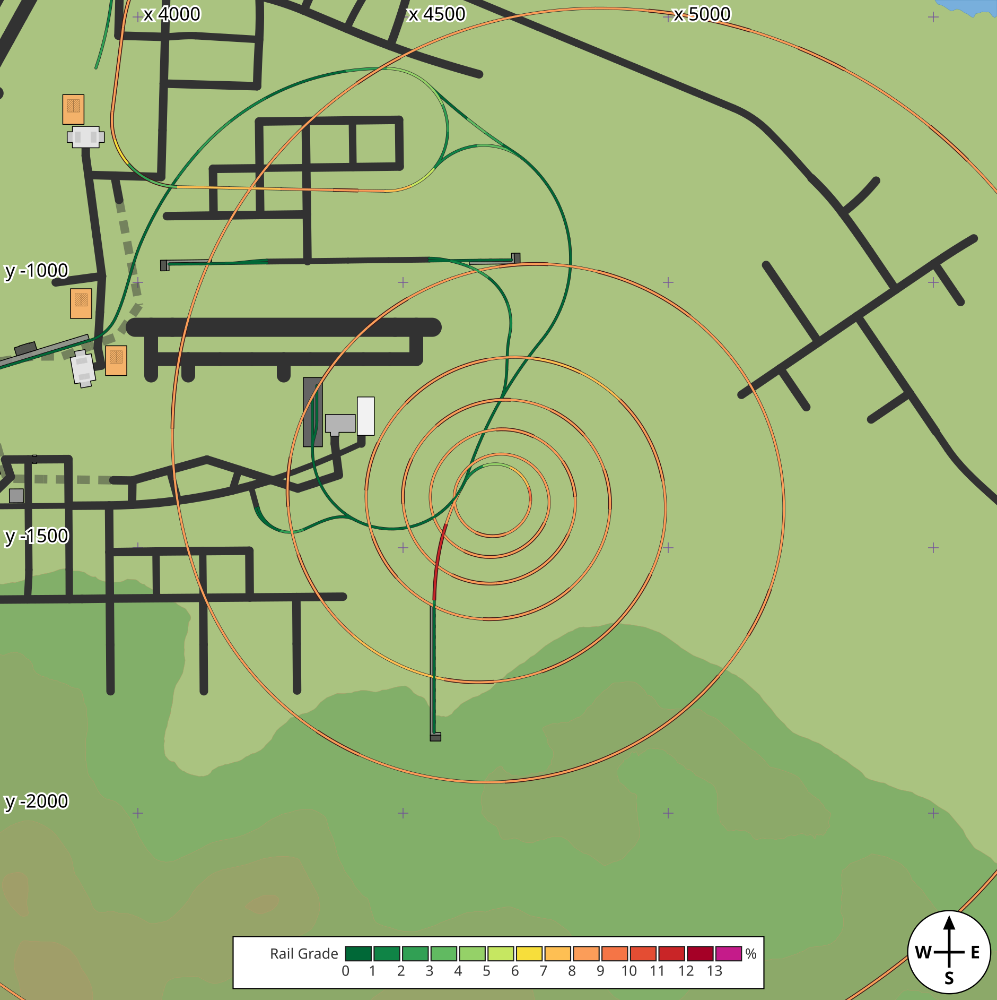
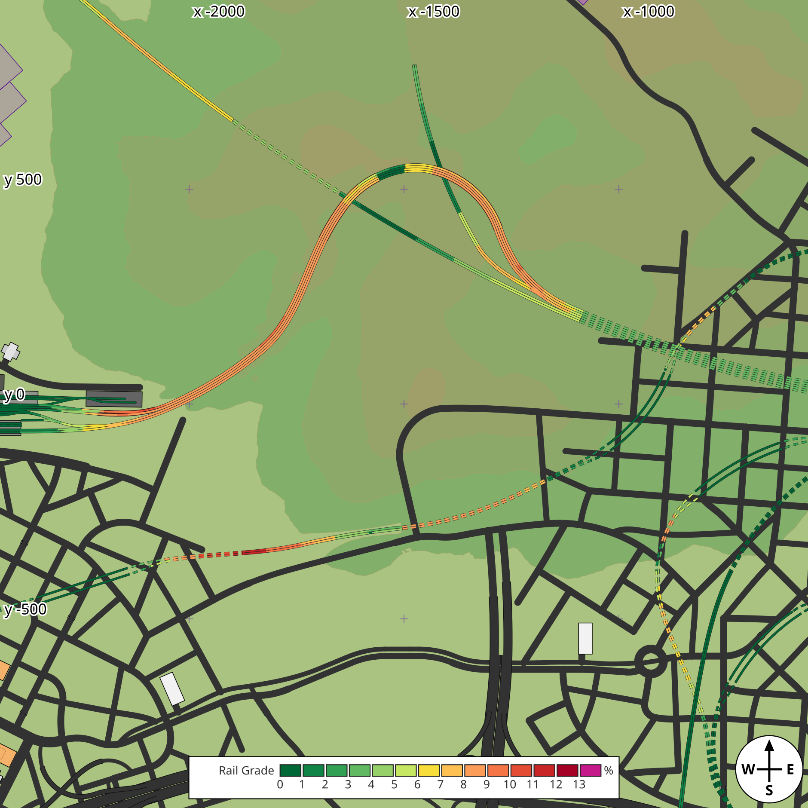
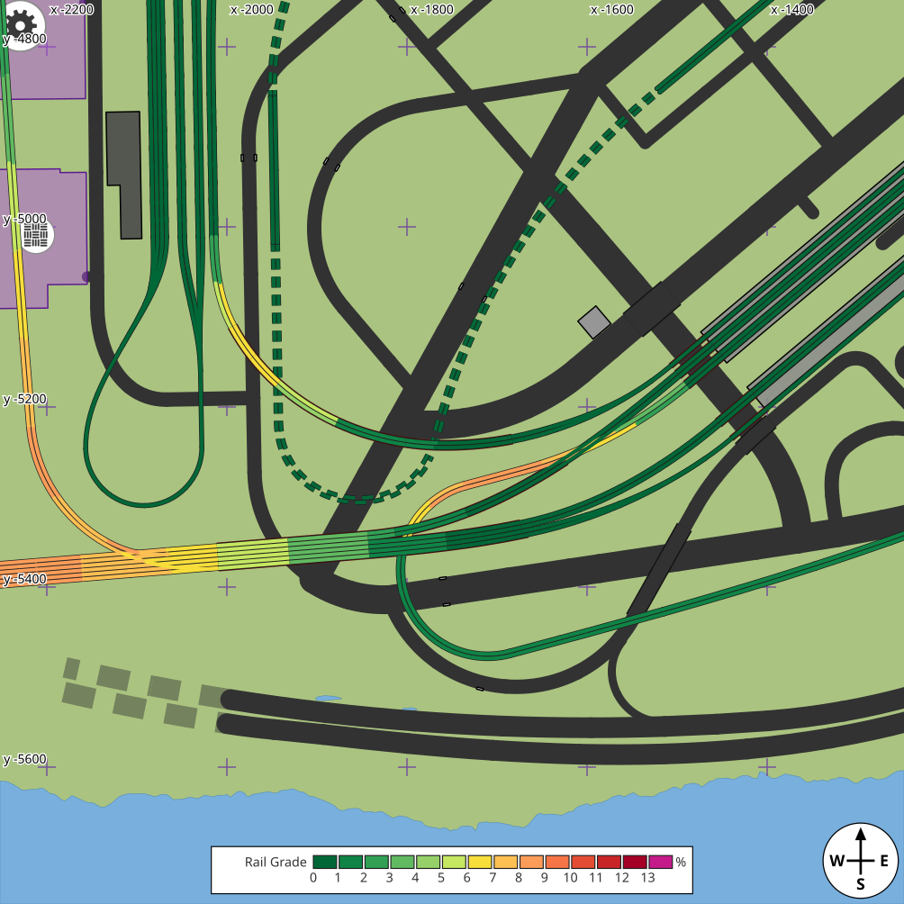
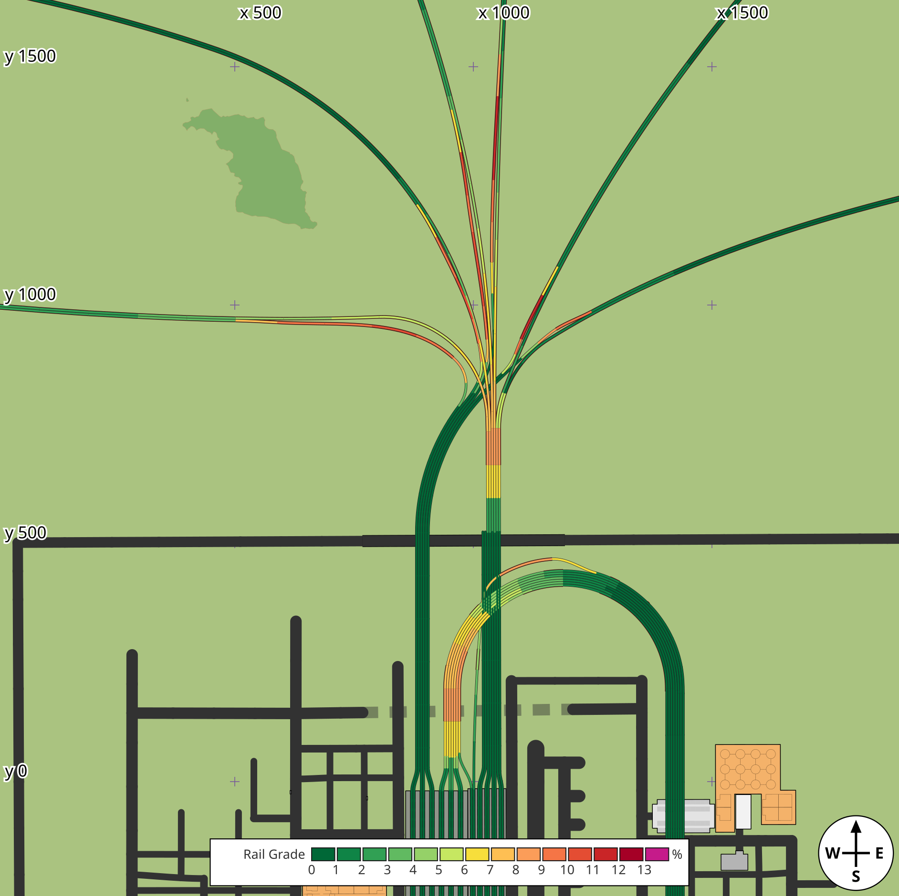
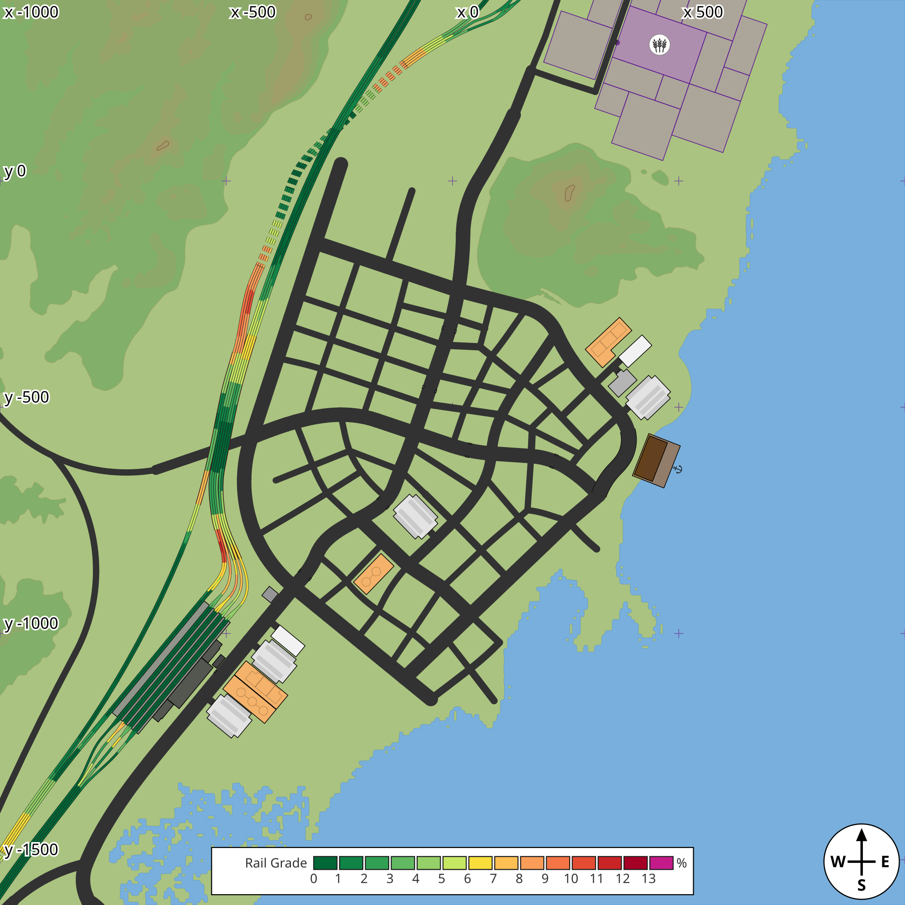

# Rail grades: examples

`tf3map SAVE --rail-grades` colours each track by its grade: the height between the edge's two ends over its length along the curve, up or down alike. At the default limit of 13 % (the steepest the game's track types allow) there is one colour per whole percent, and magenta from the limit up. `--rail-grade-limit P` squeezes the same 14 colours under a lower limit. The [README](../README.md#using-it) has the details.

Each map carries its key along the bottom: the 14 colours, with the grade at each gap between two of them.

Every map here is from a save published in the mod.io catalogue, drawn with the default vector terrain at 1 m per pixel. Click a map for the full size; in the full SVG each segment's grade is in its `data-grade` attribute. The maps are redrawn by [regenerate-examples.sh](regenerate-examples.sh).

<table>
<tr>
<td width="50%"> 
<b>A helix</b> (mod.io 6414627): six rings climbing at a steady 8 to 9 %, a red stretch where the line leaves them, and the level lines through the town beside it. 
<code>--crop 4680,-1410,940</code></td>
<td width="50%"> 
<b>A horseshoe curve</b> (mod.io 6459692): a four-track mountain line climbing in orange round the curve, tunnels at both ends (dashed), and a lower line going red into its tunnel. 
<code>--crop -1500,0,940</code></td>
</tr>
<tr>
<td> 
<b>A junction</b> (mod.io 6487589): a many-track bridge stepping from orange to green as it levels out, ramps up to the overpasses, and tunnels under the roads. 
<code>--crop -1750,-5250,500</code></td>
<td> 
<b>A fan</b> (mod.io 6433417): seven lines out of one bundle, several climbing in red and orange, the bundle stepping orange, yellow, green. 
<code>--crop 950,700,940</code></td>
</tr>
<tr>
<td> 
<b>A harbour town</b> (mod.io 6448903): a multi-track line down the west side, its tunnel dashed, with red and yellow pulls on the way into the station. 
<code>--crop 0,-600,1000</code></td>
<td></td>
</tr>
</table>

Each is `tf3map SAVE --crop X,Y,R --mpp 1 --rail-grades`.
